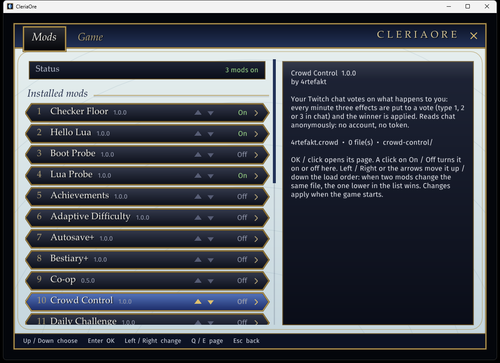
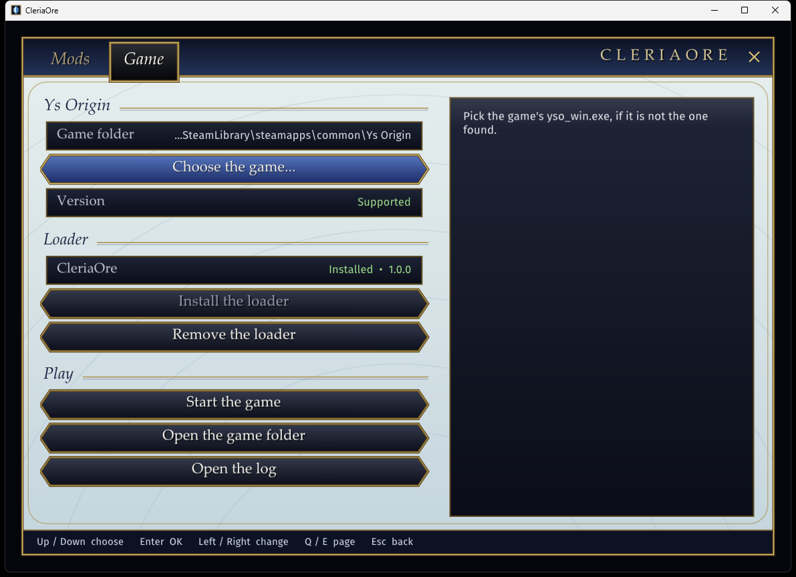

# CleriaOre

**A mod loader for Ys Origin on Steam.**

Install it once, then turn mods on and off from a small program outside the game or from a panel inside it.

-1b2838?logo=steam)

CleriaOre is a fan project. It is not made, endorsed or supported by Nihon Falcom or XSEED, and it
contains none of the game's files: you need your own copy of Ys Origin.

## ✨ What it gives you

- **Mods in the original game.** Reskins, new items and chests, and Lua-scripted mods, all in the Steam
  version you already own.
- **A manager outside the game** to install, order and remove mods, and a **panel inside it** (F1, or
  **Mods** on the title screen) for each mod's settings.
- **Nothing permanent.** Your saves are not touched, and removing the loader puts the game back exactly as
  Steam installed it.
- **The same mods as [CleriaCore](https://github.com/4rtefakt/YsOrigin-CleriaCore)**, the fan-made engine for
  Ys Origin: one mod package runs on both.

## 🚀 Install

1. Download **`CleriaOre-Setup-1.2.3.exe`** from the [latest release](../../releases/latest).
2. Close the game if it is running, then run the file. Windows may warn that it comes from an unknown
   publisher (it is not signed): choose *More info*, then *Run anyway*.
3. CleriaOre finds your game through Steam. On the **Game** page, press **Install the loader**.
4. Press **Start the game**. In the game, **F1** opens the mods panel.

That is all. CleriaOre is now in your Start menu, and the downloaded file can be deleted.

If your game is not found (it is not in a Steam library, for instance), press **Choose the game...** and
pick its `yso_win.exe`.

## 🧩 Using mods

**Find mods.** The **Get mods** page lists the mods made for CleriaOre and CleriaCore. Click one to
download its latest release, install it and turn it on.

**Add a mod.** Double-click the mod's `.cleriamod` file. Or, on the **Mods** page, press **Install a mod
file...** and pick its `.cleriamod` or `.zip`, or drop the file on the window. It is checked, copied in and
turned on. Installing a newer version of a mod you have replaces the old one and keeps its settings.

**Turn a mod on or off.** Click its **On / Off**. Changes apply the next time the game starts. A mod that
needs another one turns it on with it; a mod that cannot load says why in the list.

**Change the order.** The small arrows move a mod up or down. When two mods change the same thing, the
one lower in the list wins.

**A mod's own settings** are on its page: click the mod in the list. They are also in the game: press
**F1**, open **Mods**, then the mod (the game pauses while the panel is open). A change made outside the
game applies the next time it starts.

**Update a mod.** CleriaOre looks for updates when it opens: a mod with a newer release shows its new
version in gold in the list. Open the mod and press **Update to ...**, or press **Update N mods** above
the list. It works for mods whose `Website` is their GitHub page. Each mod's settings stay, and a mod you
had turned off stays off.

**Remove a mod.** Open the mod's page and press **Remove this mod** twice. It goes to the Recycle Bin.

**Play without mods.** Turn **Use mods** off; nothing is uninstalled.

### Mods to try

- **[Archipelago](https://github.com/4rtefakt/ys-origin-cleriacore-ap)**: play Ys Origin in a multiworld
  randomizer with friends and other games.

## 🧹 Uninstall

On the **Game** page press **Remove the loader**. The game is back to how Steam installed it. Your mods
and their settings stay in the game's `cleriaore` folder; delete that folder too if you want nothing
left.

If another mod's `dinput8.dll` was in the game folder when you installed CleriaOre, it was kept aside
and is put back now.

## 💡 Good to know

- **Which game.** The Steam version of Ys Origin for Windows, in its current build (2024-01-08). On any
  other version CleriaOre does nothing and the game runs as usual; the Game page tells you which case
  you are in.
- **Your saves** are not touched. What a mod keeps with a save goes in a separate file in the
  `cleriaore` folder, which is not synced by Steam Cloud.
- **Other DLL mods.** CleriaOre is the game folder's `dinput8.dll`. Another mod that uses the same file
  name cannot be loaded at the same time.
- **Steam Deck and Linux** are not tested.
- **Something went wrong?** The Game page has **Open the log**. It says what the loader and each mod
  did at the game's last start.

## 🛠️ Making mods

A mod for CleriaOre is a mod for [CleriaCore](https://github.com/4rtefakt/YsOrigin-CleriaCore), the
fan-made engine for Ys Origin: the same package (`mod.ini`, replacement files, Lua scripts on the
`cleria.*` API) runs on both. CleriaCore's `samples/mods/README.md` is the guide.

CleriaOre does not back all of that API on the original game yet. What works today, and how to build
CleriaOre from source, is in [docs/STATUS.md](docs/STATUS.md). What was learnt of the game's program to make
the loader work is kept with the rest of the Ys Origin research, in the private
[yso](https://github.com/4rtefakt/yso/blob/main/retail/cleriaore/RETAIL_RE.md) repository.
