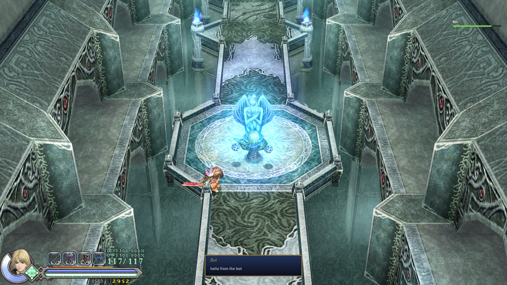
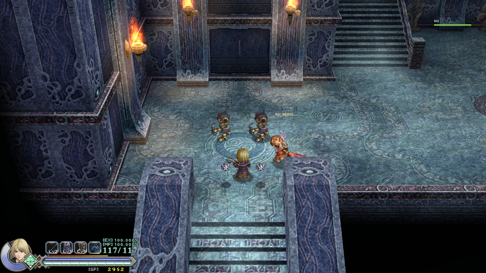

# Test protocol

What to run by hand after a batch of host work, with the **Lua Probe** mod on (it lives in the game's
`cleriaore/mods/lua_probe`; its page is F1 > Mods > Lua Probe: settings). Each step says what should
happen; if the game closes instead, note the step. Afterwards `cleriaore/cleriaore.log` holds the detail.

Already checked by driving the game (see "The drive" below): the F1 panel, a mod's window, images,
`world.actors`, the world labels, `set_actor`, `remove`, `spawn`, `set_position`, pause, speed, a placed
`pickups.ini` pickup, the HP gauge after `set_hp`. The steps below are what a script cannot easily do
alone: fighting, chests, and how things look and feel.

## 1. A fight (5 minutes)

Load a save next to monsters. On the probe page, section **Combat**, everything off.

1. Hit and kill a monster. Nothing unusual.
2. **Damage dealt x10** on: monsters die in a hit or two. Off again.
3. **Damage taken x0** on: let a monster hit you, HP stays. Off again.
4. **Kill EXP x5** and **Kill SP x5** on: a kill gives visibly more of both. Off again.
5. Section **Pickups and API 7**: **No drops** on, kill three monsters: nothing drops. Off again.
6. **Gold x10** on, **Drop a gold piece on me**, walk over it: SP rises by 100, not 10.
7. **ATK + 100** on: the stats line's ATK is 100 higher and hits are stronger. Off: back to before.

## 2. The window and the keys (1 minute)

1. **F6** in the game: a "Probe window" opens with a paragraph, a health bar and a small table, and the
   game is held. **Esc** closes it and the game goes on.
2. **Notice in 3 seconds**, close the panel: a card appears three seconds later.

## 3. A chest, with the Chest Swap sample on (5 minutes)

Chest Swap is CleriaCore's `samples/mods/chest_swap`; turn it on in the manager, then start the game.

1. **New Game**, any character, play to the first chest room (S_1001, the first room up the stairs) and
   open the chest behind the barrier monster.
2. The box says you got the **Lantern of Solace**, not the Celcetan Panacea, and a card reads "The
   Lantern of Solace glows softly." No item icon rises from the chest (a mod's own item has no icon in
   the game's table).
3. Go to the first goddess statue room (S_1009): a Roda Fruit lies beside the statue. Take it; leave the
   room and come back: it is not there again.
4. Save, quit to the title, load: the fruit stays collected.

## 4. Longer play (as long as you like)

Play normally with only the mods you would really use. What to watch for: a hitch when entering a room,
a monster that does not die at 0 HP, a level-up or an equipment change that gives odd numbers, a crash
on a boss's death.

## 5. What only a person can check

The drive cannot hear, cannot press a key in the loader's own panel, and has one install to test on. These
were made to work by the log or by reading the game's code alone:

1. **Music.** With a mod that has `files/music/YSO_004.ogg`, the first rooms (S_1001) should play that file in
   place of the game's. `cleria.audio.music("file.ogg")` from a mod should start that file, and
   `cleria.audio.music(-1)` bring the room's own music back. `cleria.audio.se_file("x.wav")` should play a WAV.
2. **A statue's line.** With Chest Swap on, cleanse the statue of S_1009 on a new game: the narration should be
   the sample's two lines, not the game's one.
3. **The load order in the panel.** F1 > Mods, the "Load order" section at the bottom: Left / Right on a row
   should move the mod, and the order should be the manager's after a restart.
4. **`player.equip`.** From a mod, equip another owned armor: the Equip page and the stats should follow.
5. **`game.unlock_character(3)`** on an install where neither Yunica nor Hugo has cleared the game: with a mod
   calling it on the title, New Game's Character Select should offer Toal's bar lit, and `record.ta2` should be
   unchanged afterwards.
6. **A melee swing, the Boost, water.** `attack` with Yunica or Toal (one event a swing of a combo), `boost`
   on and off, `jump` with `water = 1` in a flooded room, and `double = 1` with the real double jump (the
   Gold Bracelet's): each was driven only with Hugo on dry ground.
7. **Save profiles in the menus.** With a profile set on the title (Archipelago's way), the Load page should
   list only that profile's saves, and the statue's Save should write there.

## The drive

For tests without a person at the keyboard, the loader can be steered from outside. Start the game with
the environment variable `CLERIAORE_DRIVE` set; each frame it then reads, in `cleriaore/drive/`:

- `keys.txt`: the keys held, as hexadecimal DirectInput codes (`D0` Down, `34` the period key, the OK of
  the game's WASD preset); they reach the game with or without the window's focus;
- `cmd.txt`: one `cleria.command` a line (`name args`), run and the file removed; `panel` toggles F1;
  `rawactors` writes the game's whole actor list to the log. For study, `peek <addr> [n]` and `poke <addr> <value>`
  read and write the game's memory (hexadecimal; `p+<offset>` is the player's actor). `shot <name>` writes
  the frame being drawn to `drive/<name>.bmp`, as the game's device holds it: the game's picture with the
  loader's overlay, nothing of the desktop. `profile <name>` sets a save profile at any time (a mod can only on
  the title) and `steamrm <file>` deletes a file of Steam's storage, both for the save profiles' test. `nav
  up|down|left|right|ok|back` presses a key in the loader's panel or a mod's window, and `type <text>` types into a
  prompt (`nav ok` keeps it, `nav back` drops it).

The probe mod has commands for it: `actors`, `labels`, `weaken`, `remove`, `tp x y z`, `speed f`,
`hold 0|1`, `image`, `window`, and `lua <code>` for anything else.

Two cautions. The game sometimes stays on a black window at its start (seen three times in some forty starts,
the cause not found: the loader's log then stops before `[ui] ready`); `drive.ps1 -start` closes it and starts
again. And a key meant for the game also acts in its menus: on the title three OKs reach "Load this data?", and
the Load page has a Delete button. Look at a frame before confirming anything there.

`tools/drive.ps1` wraps the drive (start the game with it, hold keys, send a command, take a picture of the
window, read the log, stop). The paths at its top are this machine's.

### An elemental altar ended by `cleria.script.stop`

Archipelago ends an altar's event once its skill is withheld (the rest of the event would equip a skill the
player does not hold). With the probe on, `lua` commands: `cleria.game.skip_cutscenes(true)`, then
`ore.new_game character=1 difficulty=2` (a game begun in S_2009 directly has no HP), and in S_1000
`cleria.game.goto_room("S_2009")` and `set_flag(0x74, 1)` (a skill held, for the skill keys). A content
filter that suppresses the `talkc940` store of 0x75 and calls `cleria.script.stop()` on its store of 0x14F,
then `cleria.script.run("TalkC940")`. The filter's `stop()` answers true; the log shows the stores of 0xA5,
0x75, 0x6C, 0xB7, 0x14F and no `Get_Skill` after them; the game plays on, 0x75 is still -1, 0x14F and 0xB9
(the HUD) are 1, and `[` / `]` and the keys 1 to 3 change nothing wrong. (To run it again: 0x14F 0, 0x6C -1,
0x75 -1, and the room entered again.)

## Co-op without a second game

`tools/coop_bot.py` is a fake teammate: it joins a host on 127.0.0.1:7777 as Yunica, walks a circle in the
host's room, says one chat line, and prints what the host sends. With the Co-op mod on and, in
`cleriaore.ini`, `[cleria.mod.4rtefakt.coop]` `Auto="host"` and `Loopback="1"`:

```
python tools/coop_bot.py 20
```

What should happen in the game: a Yunica walks round the statue with "Bot" over her head, the party list
shows Bot's HP at the top right, and a card reads "Bot: hello from the bot". The bot prints `welcome`, the
host's room and pose, and the room's snapshots.



The other way round, the bot hosts and the game joins (`Auto="join"`): start `python tools/coop_bot.py host 75`
first, then the game, and go to S_1001. The bot has the lowest id, so the room's monsters are its own: its
snapshots line two or three of them up beside the entrance, held, the others fall, and its Yunica walks
round the player.


